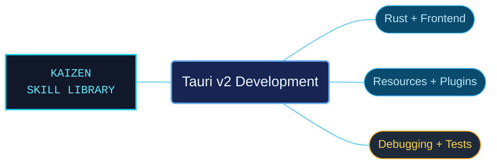

# Tauri v2 Development

Tauri v2 development references that connect frontend code, Rust application logic and desktop or mobile integration. The package is especially useful when a feature crosses those boundaries and its setup, event lifecycle or platform requirements need to be explicit.

Use when developing Tauri v2 desktop or mobile applications: configuration, Rust commands, frontend events and channels, shared state, resources and sidecars, dependency updates, icons, debugging, plugins, mobile permissions, IPC mocks, Selenium or WebdriverIO tests. Not for Tauri v1.

## What this skill helps with

| Task | Useful reference material |
| --- | --- |
| [Connect Rust and the frontend](references/rust-commands-events-index.md) | Choose command and event guidance, including registration and listener lifecycle details. |
| [Bundle resources and sidecars](references/resources-sidecars-index.md) | Find resource paths, external-process setup and the associated platform conditions. |
| [Build plugins](references/plugin-development-index.md) | Follow plugin development routes and continue into mobile-specific guidance where needed. |
| [Debug and test an application](references/webdriver-testing-index.md) | Find browser-driver testing workflows alongside the separate debugging and IPC-mock references. |

## The work behind the references

The references have been reorganized into descriptive topics with linked setup and continuation files. Identified formatting and code-example defects were repaired during source review, including command registration and workflow examples; complete examples and illustrative fragments are distinguished.

## Start here

Start with [SKILL.md](SKILL.md) and follow its context routes.

Use this package with Tauri v2. Read each example's linked setup, dependencies and target-platform conditions before adapting it. Begin with [configuration](references/development-configuration-index.md) or [debugging tools](references/debugging-tools-index.md) when the application context is not yet established.

## Sources and license

Skill reference documentation is interpreted content for use in open source projects. Check against [official documentation sources](https://v2.tauri.app/develop/) when dealing with defects or issues that may come up from interpreting this skill's references.

Licensed under **AGPL-3.0**; see [LICENSE](LICENSE). Part of the [Agent Kaizen](https://github.com/LevyBytes/agent-kaizen) skill library.
