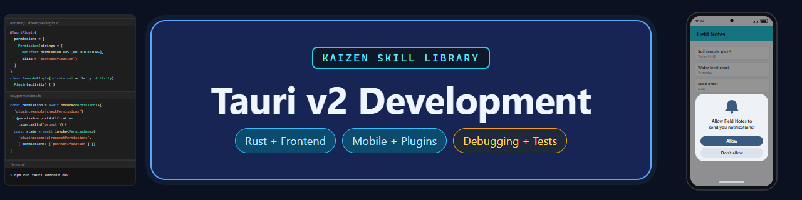

# Tauri v2 Development Agent Skill



Gives Claude Code, Codex and other coding agents 135 focused references for building Tauri v2 desktop and mobile apps: configuration, Rust commands, events and channels between Rust and the frontend, managed state, resources and sidecars, icons, debugging, plugins and mobile plugins, IPC mocks, and Selenium and WebdriverIO tests. It also carries web platform guidance for the app's WebView interface, adapted to WebView2, Android WebView, WKWebView and WebKitGTK. Tauri v1 is not covered.

**Status: early draft.** The reference pages are in place; scripts, assets and evaluations will be added over time.

## Install

```sh
npx skills add LevyBytes/AI-SKILL-tauri-develop -g
```

This installs the skill as `tauri-develop` for each coding agent it finds on your computer; without `-g` it goes into the current project only. The command needs Node.js 22.20 or later.

<details>
<summary>Install without Node.js</summary>

Clone the repository into your agent's skills folder:

| Agent | Command |
| --- | --- |
| Claude Code | `git clone https://github.com/LevyBytes/AI-SKILL-tauri-develop ~/.claude/skills/tauri-develop` |
| Codex | `git clone https://github.com/LevyBytes/AI-SKILL-tauri-develop ~/.agents/skills/tauri-develop` |

</details>

## Use

Ask your agent about your Tauri app as usual; it loads the skill when a task matches. You can also call it by name with `/tauri-develop` in Claude Code or `$tauri-develop` in Codex.

- "How do I return a typed error from a Tauri command to the frontend?"
- "How do I stream download progress from Rust to the frontend with a channel?"
- "How do I bundle a sidecar binary and allow it only specific arguments?"
- "How do I mock Tauri IPC commands in frontend unit tests?"
- "How do I run WebdriverIO end-to-end tests for my Tauri app in GitHub Actions?"

## What's inside

| Area | Pages | Covers |
| --- | ---: | --- |
| [Configuration and development](references/development-configuration-index.md) | 7 | Configuration formats, build variants, platform-specific configuration, Cargo and npm manifests |
| [Rust commands and events](references/rust-commands-events-index.md), [calling the frontend](references/rust-frontend-communication-index.md) | 35 | Registering commands, arguments and return data, errors, async commands, raw requests, events in both directions, event targets, channels, JavaScript evaluation, listener cleanup in React, Vue and Svelte |
| [Managed state](references/managed-state-index.md) | 5 | Registering and accessing state, choosing a mutex, exact state types |
| [Resources and sidecars](references/resources-sidecars-index.md) | 14 | Bundling and resolving resources, read permissions, naming and running sidecar binaries, argument allowlists |
| [App icons](references/app-icons-index.md), [dependency updates](references/npm-cargo-dependency-updates.md) | 4 | Generating icons, platform icon formats, keeping npm packages and Cargo crates in step |
| [Debugging](references/debugging-tools-index.md) | 15 | The WebView inspector, production builds, CrabNebula DevTools, VS Code, Neovim and JetBrains debugging, Linux graphics failures |
| [Plugins](references/plugin-development-index.md) | 14 | Plugin setup and naming, Rust APIs and commands, lifecycle hooks, command permissions, permission sets and scope schemas |
| [Mobile](references/mobile-plugin-development-index.md) | 21 | The mobile development server and devices, Android and iOS plugins, mobile commands, arguments and permissions, Rust bridges through JNI and FFI |
| [IPC mocks](references/frontend-ipc-event-mocks.md) | 6 | Mocking commands, events, windows and shell commands, spying on commands |
| [WebDriver testing](references/webdriver-testing-index.md) | 14 | Platform drivers, Selenium and WebdriverIO projects, test lifecycles, GitHub Actions |
| [Web surfaces](references/web-surfaces.md) | 1,495 | The WebView interface: HTML, forms, components, accessibility, CSS layout, interaction, performance, security and passkeys, privacy, built-in AI APIs, WebMCP and WebAssembly, with what changes inside a Tauri window |

## When agents load this skill

Use when developing Tauri v2 desktop or mobile applications: configuration, Rust commands, frontend events and channels, shared state, resources and sidecars, dependency updates, icons, debugging, plugins, mobile permissions, IPC mocks, Selenium or WebdriverIO tests. Not for Tauri v1.

## The work behind the references

The references have been reorganized into descriptive topics with linked setup and continuation files. Formatting and code-example defects found during source review were repaired, including command registration and workflow examples, and complete examples are marked apart from illustrative fragments. The web surface pages come from the [Modern Web Development](https://github.com/LevyBytes/AI-SKILL-modern-web-development) skill, with a router page for what differs in a native WebView.

## Contributing

Pull requests are accepted from approved contributors only. To propose a fix or a feature, first open an issue that describes the change your pull request would make, such as an example that fails on Tauri v2 or a plugin API that changed, and the Tauri documentation it should match. The maintainer reviews the issue and your GitHub account, then approves or declines. New maintainers are approved the same way. See [CONTRIBUTING](.github/CONTRIBUTING.md).

## Sources and license

Skill reference documentation is interpreted content for use in open source projects. Check against [official documentation sources](https://v2.tauri.app/develop/) when dealing with defects or issues that may come up from interpreting this skill's references.

Licensed under **Apache-2.0**; see [LICENSE](LICENSE). Part of the [Agent Kaizen](https://github.com/LevyBytes/agent-kaizen) skill library.
